# Практическая работа №2. Часть 1. Command Line Interface

## Выход из песочницы

До настоящего момента работа с программой осуществлялась в изолированной среде - в среде разработки либо непосредственно в браузере. Мы вводили код, нажимали кнопку запуска, происходила некоторая магия и перед вами возникало окно для взаимодействия с приложением.

<p align="center">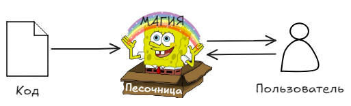</p>

Однако за этой магией скрывалась полноценная технологическая цепочка. Разрабатываемые нами решения являлись законченными программными продуктами, идентичными любым другим приложениям, установленным на компьютере. При запуске среда разработки выполняла компиляцию исходного кода в исполняемый файл, после чего операционная система инициировала отдельный процесс - именно с этим процессом и происходило пользовательское взаимодействие.

<p align="center">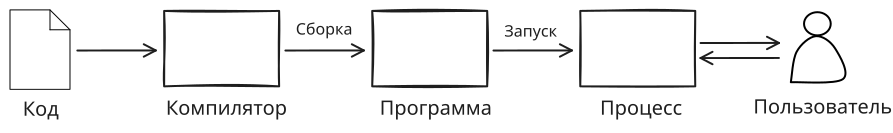</p>

Ключевой момент заключается в том, что итоговый исполняемый файл представляет собой автономный программный продукт. Он не зависит от среды разработки и может быть развёрнут и запущен как на локальной машине, так и на любой другой системе.

## Запуск

Программы можно условно разделить на два типа: с графическим интерфейсом (GUI - Graphical User Interface) и консольные приложения с текстовым интерфейсом: CLI (Command Line Interface) или TUI (Text User Interface). CLI - это командный интерфейс работающий в терминале, а TUI - более развитый текстовый интерфейс, но тоже работающий в терминале.

Принципиальной разницы между GUI и консольными программами нет. Появление графического интерфейса сводится к вызову простых функций из графической библиотеки. По своей природе эти функции сопоставимы с теми, что мы уже использовали ранее (например, при работе с `std::vector`).

Функции работы с окнами не рисуют сами: они лишь уведомляют об этом другую запущенную программу - графическую подсистему ОС или оконный менеджер, и уже она создаёт окно, размещает элементы управления и выполняет отрисовку. Само приложение в этот момент лишь ждёт результата, как при любом обычном вызове функции.

Отсюда ограничение: GUI‑программа работает только там, где есть подходящая графическая подсистема. Если её нет, вызовы функций просто не сработают - окна не появятся и программа упадёт с ошибкой. Консольные приложения используют только стандартные механизмы ввода‑вывода, которые существуют в любой ОС, поэтому работают практически везде.

В Windows (изначально заточенная под графику ОС) тип приложения указывается в исполняемом файле. Если программа отмечена как консольная, то при её запуске Windows автоматически создаёт окно терминала и подключает наше приложение к нему, а для GUI-программы окно терминала создано не будет. При этом даже консольная программа может создать графическое окно; тогда будут показаны и консоль, и окно. В Linux и macOS аналогичного поля в исполняемом файле нет, т.к. графика в них является отдельным, опциональным компонентом, поэтому поведение при запуске программы зависит от окружения: наличия графической сессии, способа запуска и настроек системы. Как вариант, консольное приложение может запуститься и работать вовсе без окна.

Для примера возьмём простое консольное приложение:

```c++
#include <iostream>

int main(){
    std::cout << "Hello, world!" << std::endl;
    std::cin.get(); // Ждёт ввода. Чтобы окно не закрылось сразу
}
```

Для наглядности скомпилируем эту программу на Windows. На других ОС ситуация не меняется:

```bash
g++ main.cpp -o main.exe
```

В текущей папке появится исполняемый (**exe**cutable) файл `"main.exe"`.

<p align="center">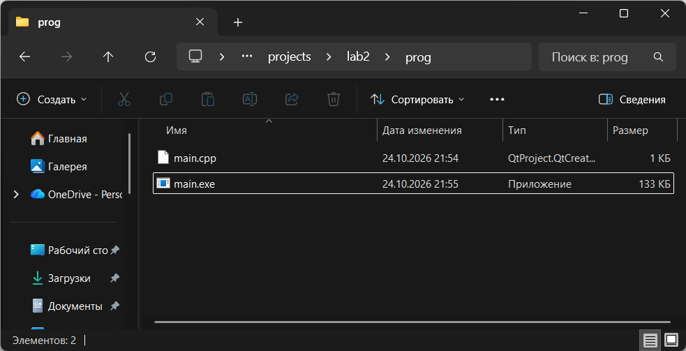</p>

В **графической среде** программу обычно запускают **двойным щелчком мыши** по исполняемому файлу. Поступим так же с нашей программой:

<p align="center">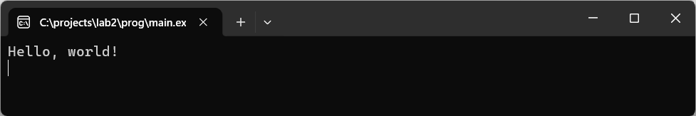</p>

Как видно, открылось окно в котором появился текст и программа перешла в режим ожидания ввода. После нажатия <kbd>Enter</kbd> программа завершится, и окно закроется. Без `cin.get()` окно закрылось бы моментально, просто моргнув на экране.

Как уже говорилось выше, у нашей программы **нет своего окна** - она его просто не создаёт. Окно создаёт операционная система, а стандартный ввод/вывод программы подключается к вводу/выводу этого окна.

<p align="center"></p>

Если графической среды нет или командная оболочка уже открыта, программу можно запустить, указав полный или относительный путь к исполняемому файлу. Например, файл можно просто перетащить в терминал - путь к нему пропишется автоматически.

<p align="center">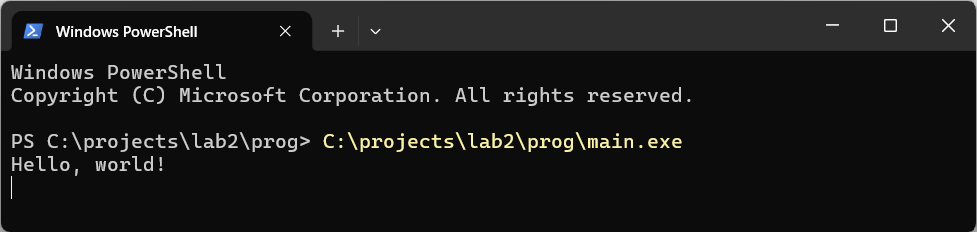</p>

В этом случае после выхода из программы, окно не закроется, а продолжит работать.

<p align="center">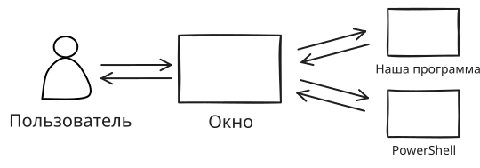</p>

Командная оболочка (на скриншоте - PowerShell) на время работы нашей программы просто "молчит": она не читает ввод и не пишет в вывод. Т.к. окно консоли общее, то если бы оболочка и наша программа читали одновременно, они бы конкурировали за одни и те же символы, и ввод достался бы то одному, то другому, но не обоим сразу, а в случае вывода на экране была бы смесь выводов от обеих программ. Когда наша программа закрывается, оболочка узнаёт об этом и снова начинает обрабатывать ввод и вывод самостоятельно.

<hr>

> [!WARNING]
>
> Все дальнейшие инструкции и команды будут исходить из того, что у вас созданы две папки: `"tools"` и `"projects"`. В моём случае это: `"C:\tools"` и `"C:\projects"` для Windows и `"~/tools"` и `"~/projects"` для Linux.
> Вы можете разместить `"tools"` и `"projects"` в удобное для вас место, но учитывайте это внося соответствующие изменения в команды.
>
> Выбирая пути к каталогам `"tools"` и `"projects"` избегайте промежуточных каталогов с русскими (и вообще не латинскими) символами, т.к. некоторые инструменты могут начать вести себя непредсказуемым образом.
> Если название промежуточного каталога будет содержать пробел, то в командах весь путь обязательно нужно заключить в кавычки.

## Код возврата/ошибки

> [!WARNING]
>
> Этот раздел можно выполнять на любой ОС по вашему выбору, либо в Docker-контейнере, либо на виртуальной машине, либо в WSL и т.д.

Завершаясь, программа сообщает запустившему её процессу число, показывающее, успешно ли она выполнилась. Это число называют кодом возврата или кодом ошибки. В общем случае различают только два варианта: `0` - успешное выполнение и любое ненулевое значение - что-то пошло не так. Какой именно код возвращать и, что именно означает успешное выполнение, решает программист; вполне допустимо всегда возвращать `0`.

Описанный процесс работает одинаковым образом для большинства популярных ОС.

### C++

1. В каталоге `"projects"` создайте каталог `"lab2"`;

2. В `"lab2"` создайте каталог `"return"`, а в нём каталог `"cpp"`;

3. В терминале перейдите в `"projects\lab2\return\cpp"` или запустите в этом каталоге `vscode`, по вашему выбору;

4. Создайте файл: `"main.cpp"` содержащий:

   ```c++
   #include <iostream>
   
   int main(){
       std::cout << "Task running..." << std::endl;
       return 0; // Если не указать эту строку всё равно будет код возврата 0
   }
   ```

5. Скомпилируем программу командой:

   ```bash
   # Windows (только в оболочке cmd или PowerShell)
   g++ main.cpp -o main.exe
   
   # Другая ОС
   g++ main.cpp -o main
   ```

   В Windows расширение `.exe` тоже можно не указывать - так же, как в других ОС его можно указать. Наличие, отсутствие или изменение расширения (например, на `.png`) не повлияют на содержимое выходного файла. Расширение влияет только на отображаемую иконку и на программу которой будет передан файл при дабл клике на нём. Для запуска в терминале разницы нет вообще.

6. Запустите программу:

   ```bash
   # Windows (cmd или PowerShell)
   .\main.exe
   
   # Другая ОС
   ./main
   ```

   Обратите внимание, что перед именем файла указано `./`. Точка - это специальный символ, который обозначает путь к текущему каталогу. Если попробовать запустить программу просто указав её имя, то мы получим ошибку, т.к. оболочка по умолчанию будет искать данный файл в каталогах перечисленных в переменной окружения `PATH`, но НЕ в текущем каталоге. Именно для этого мы и добавляли в начало `./`, чтобы указать оболочке, что `"main"` нужно искать в текущем каталоге.

   У оболочки `cmd` правила поиска отличаются. Если программа не будет найдена в `PATH`, то `cmd` будет искать программу в текущем каталоге.

7. Следом выполните команду:

   ```bash
   # PowerShell
   echo $LASTEXITCODE # Вывод в виде числа
   # или
   echo $? # Вывод в виде True или False
   
   # cmd
   echo %ERRORLEVEL%
   
   # bash (WSL / Git Bash / Linux)
   echo $?
   ```

   На экране должен появиться `0`.

   После завершения программы/команды оболочка записывает её код возврата в специальную переменную, которую можно получить.

8. Запустите программу следующим образом:

   ```bash
   # PowerShell 7+ (на более ранних версиях работать не будет)
   .\main.exe && echo "Успешное выполнение"
   .\main.exe || echo "Провал"
   
   # cmd
   .\main.exe && echo "Успешное выполнение"
   .\main.exe || echo "Провал"
   
   # bash (WSL / Git Bash / Linux)
   ./main && echo "Успешное выполнение"
   ./main || echo "Провал"
   ```

   Вы должны получить в выводе *"Успешное выполнение"* , а *"Провал"* нет.

   Здесь используется связка из двух программ: нашей и `echo` (просто печатает свой аргумент) при помощи операторов `&&` и `||`. Первый оператор запускает вторую команду только при успешном завершении первой (код возврата `0`); при ошибке вторая команда не запускается. Оператор `||` действует наоборот: запускает вторую команду только при неуспешном завершении первой (ненулевой код возврата).

9. Измените код `"main.cpp"` на:

   ```c++
   #include <iostream>
   
   int main(){
       std::cout << "Task running..." << std::endl;
       return 1; //  Или любой другой в диапазоне 1–255 
   }
   ```

   и скомпилируйте:

   ```bash
   # Windows (только в оболочке cmd или PowerShell)
   g++ main.cpp -o main.exe
   
   # Другая ОС
   g++ main.cpp -o main
   ```

   Конкретное **ненулевое** значение кода возврата не интерпретируется командной оболочкой и операторами `&&`/`||`: для них важно только, равен ли код нулю (True) или нет (False). Конкретные значения кодов возврата разработчик может задавать сам и при необходимости прописать в документации.

10. Запустите программу:

    ```bash
    # PowerShell 7+ (на более ранних версиях работать не будет)
    .\main.exe && echo "Успешное выполнение"
    .\main.exe || echo "Провал"
    
    # cmd
    .\main.exe && echo "Успешное выполнение"
    .\main.exe || echo "Провал"
    
    # bash (WSL / Git Bash / Linux)
    ./main && echo "Успешное выполнение"
    ./main || echo "Провал"
    ```

    На этот раз в выводе должна быть фраза *"Провал"*,  а *"Успешное выполнение"*  нет.

### Go

11. В `"projects\lab2\return"` создайте каталог `"go"` и перейдите в него;

12. Создайте файл: `"main.go"` содержащий:

    ```go
    package main
    
    import (
    	"fmt"
    	"os"
    )
    
    func main() {
    	fmt.Println("Task running...")
    	os.Exit(0) // Если не указать эту строку всё равно будет код возврата 0
    }
    ```

13. Инициализируйте новый модуль (можно назвать это проектом) в текущем каталоге:

    ```bash
    go mod init main
    ```

    В результате должен появится файл `"go.mod"`.

14. Скомпилируем программу:

    ```bash
    go build .
    ```

    В текущем каталоге появится исполняемый файл `"main.exe"` на Windows и `"main"` на других ОС. Компилятор Go подставит расширение автоматически.

15. Запустите программу:

    ```bash
    # PowerShell 7+ (на более ранних версиях работать не будет)
    .\main.exe && echo "Успешное выполнение" || echo "Провал"
    
    # cmd
    .\main.exe && echo "Успешное выполнение" || echo "Провал"
    
    # bash (WSL / Git Bash / Linux)
    ./main && echo "Успешное выполнение" || echo "Провал"
    ```

    Вы должны получить в выводе *"Успешное выполнение"* , а *"Провал"* нет. Если бы приложение вернуло что-то не нулевое, то в выводе был бы "Провал".

16. Измените код `"main.go"` на:

    ```c++
    package main
    
    import (
    	"fmt"
    	"os"
    )
    
    func main() {
    	fmt.Println("Task running...")
    	os.Exit(1)  //  Или любой другой в диапазоне 1–255 
    }
    ```

17. Повторно скомпилируем программу:

    ```bash
    go build .
    ```

18. Запустите программу:

    ```bash
    # PowerShell 7+ (на более ранних версиях работать не будет)
    .\main.exe || .\main.exe || .\main.exe || echo "Все попытки провалились"
    
    # cmd
    .\main.exe || .\main.exe || .\main.exe || echo "Все попытки провалились"
    
    # bash (WSL / Git Bash / Linux)
    ./main.exe || ./main.exe || ./main.exe || echo "Все попытки провалились"
    ```

Коды возврата используются не только в цепочках запуска программ, но и в скриптах исполняемых оболочкой (в условиях `if`/`while`). Как правило других применений у них нет.

## Конфигурирование программы

Для собранной программы существует несколько основных способов настроить её под конкретные условия запуска, особенности окружения и требуемые задачи. Их можно выстроить в чёткую иерархию, которая определяет, какой источник имеет приоритет. В основе этой иерархии лежит принцип: чем "ближе" источник к моменту запуска, тем выше его приоритет.

Типичная иерархия источников конфигурации для консольного или графического приложения, от самого низкого приоритета к самому высокому:

1. Значения по умолчанию в коде (In-Code Defaults):

   - Низший приоритет. Это разумные значения переменных по умолчанию, которые должны позволить приложению запуститься и работать в стандартных условиях или корректно завершиться, в условиях, если данных для нормальной работы будет не достаточно.
   - Пример: `string log_level = "warning";`

2. Файлы конфигурации:

   - Средний приоритет. Это обычные текстовые файлы, как правило в формате `ключ=значение` или другом словаре-подобном формате. Программа читает эти файлы при старте и загружает значения переменных. Загруженные данные заменяют значения по умолчанию прописанные в коде.

     Часто применяется многоуровневый подход: базовый файл (`"app_config.yaml"`), который переопределяется локальным файлом (`"app_config_local.yaml"`) или несколькими файлами с любым именем, но сложенными в определённый каталог (`"app_config.d/*"`).

   - **Важно:** 12-факторное приложение предостерегает от хранения конфигурационных файлов в репозитории с кодом. Допускается размещать в репозитории примеры конфигов.

   - Пример: `config.yaml`, `settings.json`, `.env` файл.

3. Переменные окружения (Environment Variables):

   - Высокий приоритет. [12-факторная методология](https://12factor.ru/) разработки приложений настоятельно рекомендует этот метод для конфигурации, которая меняется между средами (разработка, тестирование, production). Переменные окружения задаются на уровне операционной системы и позволяют задавать требуемое поведение приложений без изменения их кода или передачи параметров каждому приложению отдельно.  
     Переменные среды обрабатывается после конфиг-файлов и заменяют своими значениями как значения по умолчанию, так и данные из конфигов.
   - Пример: `APP_PORT=8080 APP_LOG_LEVEL=debug ./main`

4. Аргументы командной строки (CLI-флаги, ключи, опции):

   - Наивысший приоритет. Аргументы командной строки всегда переопределяют любые другие настройки. Они позволяют передать значения переменных, специфичные для конкретного запуска, или временно изменить поведение по умолчанию.
   - **Примечание:** работа с аргументами в Windows с точки зрения программиста ничем не отличается от работы с аргументами в Linux. Единственное отличие может быть в принятых соглашениях командной оболочки. Например, **встроенные** команды в оболочке `cmd`, как правило, для обозначения ключей используют не `-`, а `/`.
   
     Т.е. если вы специально разрабатываете программу под `cmd`, возможно стоит дополнительно добавить в свою программу обработку ключей, начинающихся с `/`, хотя бы для вызова справки.
   - Пример: `./main --port=8080 --log-level=debug`, `dir /B /D`, `dir /?`

Представленная иерархия поддерживается большинством существующих библиотек для работы с конфигурацией - например, `viper` (Go), `python-dotenv` (Python), `boost::program_options` (C++), а также встроенными механизмами фреймворков вроде `Spring` (Java) или `ASP.NET Core` (.NET).

Особо чувствительные данные (пароли, токены доступа, API-ключи и др.) могут передаваться в программу через специальные хранилищах секретов (HashiCorp Vault, AWS Secrets Manager, Azure Key Vault, GCP Secret Manager и др.), а не в обычных конфигурационных файлах.

### Аргументы командной строки

> [!WARNING]
>
> Этот раздел можно выполнять на любой ОС по вашему выбору, либо в Docker-контейнере, либо на виртуальной машине, либо в WSL и т.д.

#### C++

19. В `"projects\lab2"` создайте каталог `"arguments"`, а в нём каталог `"cpp"`;

20. В терминале перейдите в `"projects\lab2\arguments\cpp"` или запустите в этом каталоге `vscode`, по вашему выбору;

21. Создайте файл: `"main.cpp"` содержащий:

    ```cpp
    #include <iostream>
    
    int main(int argc){
        std::cout << argc << std::endl;
    }
    ```

    Как видно у функции `main` теперь есть один параметр `argc`. Имя параметра может быть любым, но обычно используют `argc` (*arguments count*).

22. В терминале выполните команду:

    ```bash
    g++ main.cpp
    ```

    Данной командой мы запустили компилятор `g++` и в качестве **аргумента** передали файл с исходным кодом `main.cpp`. В результате, в текущем каталоге должен быть создан файл `"a.out"` (имя по умолчанию для исполняемого файла). Если vscode его не показывает, нажмите символ `↻`.

    В терминале может появится предупреждение (*warning*). Игнорируйте его.

23. Выполните команду:

    ```bash
    ls
    ```

    В результате, вы получите список файлов и каталогов в текущем рабочем каталоге. На текущий момент должно быть 2 файла.

24. Выполните команду:

    ```bash
    ./a.out
    ```

    В результате работы программы вы должны получить единицу.

25. Выполните команды:

    ```bash
    ./a.out a
    ./a.out -a
    ./a.out -a --b ---c
    ./a.out -m "hello world"
    ```

    Как видно, в результате на экран выводится число на единицу больше чем количество аргументов переданных программе. Это связано с тем, что первым аргументом программа получает своё имя (точнее, то как мы запустили программу).

26. Модифицируйте файл `"main.cpp"` следующим образом:

    ```cpp
    #include <iostream>
    
    int main(int argc, char** argv){
        for(int i=0; i<argc; i++)
            std::cout << i << ": " << argv[i] << std::endl;
    }
    ```

    Как видно, к списку параметров функции `main` добавился `argv` (*arguments values*).

    Перед запуском программы ОС складывает все её аргументы в один непрерывный блок памяти в виде последовательности С-строк. `argv` - это массив указателей, каждый из которых указывает на начало соответствующего аргумента в этом блоке; сам `argv` устанавливается на начало массива указателей.

    <p align="center">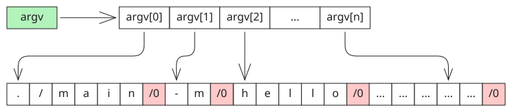</p>

    >Тип `char*` используется для обозначения С-строки, то есть массивов символов, завершающихся нулевым байтом (`\0`). Например: `char* str = "Hello, World!";` - это указатель на массив из 14 элементов: 13 символов и нулевой байт, который добавляется автоматически.
    >
    >При выводе `cout << str;`, `cout` будет печатать все символы из этого массива, пока не достигнет `\0`.
    >
    >Параметр `char** argv` также можно записать в виде `char* argv[]`, что является тем же самым с точки зрения компилятора (array-to-pointer decay). То есть `argv` здесь - это массив C-строк.
    >
    >Длина массива определяется параметром `argc`.

27. Скомпилируйте обновлённую программу:

    ```bash
    g++ main.cpp -o main # Так тоже можно: g++ -o main main.cpp
    ```

    Здесь `-o` - это ключ с параметром. В качестве параметра указано имя выходного-исполняемого файла созданного как результат компиляции (вместо дефолтного `"a.out"`).

    В результате, в текущем каталоге должен появится файл `"main"`.

28. Выполните команды:

    ```bash
    ./main a
    ./main -m hello world
    ./main -m "hello world"
    ```

    Как видно, в результате на экран выводится имя программы и все её аргументы.

29. Создайте в текущем каталоге файл `"app.log"` содержащий:

    ```
    INFO starting up
    DEBUG loading config
    INFO connected to db
    WARN slow query 1200ms
    ERROR timeout on db
    ERROR disk full
    INFO shutting down
    ```

    Этот файл имитирует лог работы некоторой программы.

30. Создайте в текущем каталоге файл `"logstat.cpp"` содержащий:

    ```cpp
    #include <iostream>
    #include <fstream>
    #include <string>
    
    // -- дефолтные настройки в коде --
    std::string g_level = "ERROR";    // Максимальный уровень
    std::string g_file  = "app.log";  // Имя файла с логами
    
    // -- значимость уровня: DEBUG < INFO < WARN < ERROR --
    int rank(const std::string& level) {
        if (level == "DEBUG") return 0;
        if (level == "INFO")  return 1;
        if (level == "WARN")  return 2;
        if (level == "ERROR") return 3;
        return -1;
    }
    
    // -- обработка записей в логе --
    void process(std::istream& in) {
        int max_rank = rank(g_level);
        std::string line;
        while (std::getline(in, line)) {
            std::string level = line.substr(0, line.find(' '));
            if (rank(level) > max_rank) continue;   // критичнее порога — пропускаем
            std::cout << line << "\n";
        }
    }
    
    int main() {
        std::ifstream log(g_file); // Открываем файл с логом
        process(log);
        // Закрывать файл log не нужно. Деструктор это сделает при выходе их блока
    }
    ```

    Здесь представлена программа, для анализа логов. Как видно, она не принимает аргументы, но содержит настройки зашитые в переменных. Имя файла и максимальный уровень выводимых логов фиксированы.

31. Скомпилируйте программу и запустите её:

    ```bash
    g++ logstat.cpp -o logstat
    ./logstat
    ```

    Как видно, программа отобразила все записи из лог-файла.

32. Изменим код так, чтобы имя файла указывалось пользователем как **обязательный позиционный** аргумент программы. Такие аргументы должны быть указаны строго в определённом месте и строго в определённом порядке:

    ```cpp
    #include <iostream>
    #include <fstream>
    #include <string>
    #include <cstdlib>
    
    // -- дефолтные настройки в коде --
    std::string g_level = "ERROR"; // Максимальный уровень
    std::string g_file  = "";      // <- Теперь тут пусто
    
    // -- обработка флагов --
    void parse_args(int argc, char** argv) {
        if (argc > 1) g_file = argv[1]; // Если есть аргумент, то это имя файла
    }
    
    // -- значимость уровня: DEBUG < INFO < WARN < ERROR --
    int rank(const std::string& level) {
        if (level == "DEBUG") return 0;
        if (level == "INFO")  return 1;
        if (level == "WARN")  return 2;
        if (level == "ERROR") return 3;
        return -1;
    }
    
    // -- обработка записей в логе --
    void process(std::istream& in) {
        int max_rank = rank(g_level);
        std::string line;
        while (std::getline(in, line)) {
            std::string level = line.substr(0, line.find(' '));
            if (rank(level) > max_rank) continue;
            std::cout << line << "\n";
        }
    }
    
    int main(int argc, char** argv) {
        parse_args(argc, argv);
        if (g_file.empty()) {  // Если имя не задано
            std::cerr << "ERROR Need to specify the file name" << std::endl; 
            return 1; // нет файла — ошибка
        }
        std::ifstream log(g_file);
        process(f);
    }
    ```

    Здесь используется поток ошибок `std::cerr` для вывода на экран информации об ошибке. В отличие от `std::cout`, который накапливает данные внутри перед выводом, у `std::cerr` нет внутреннего буфера и вся информация попадает на экран сразу. Если программа упадёт, то часть данных может застрять в буфере `std::cout` так и не отобразившись на экране, а с `std::cerr` такого не произойдёт.

33. Скомпилируйте программу и запустите её:

    ```bash
    g++ logstat.cpp -o logstat
    ./logstat
    ./logstat app.log
    ```

    В первом случае вы должны получить ошибку, а во втором вывод записей и лог-файла.

34. Изменим код следующим образом:

    - Измените функцию `main`:

      ```cpp
      int main(int argc, char** argv) {
          parse_args(argc, argv);
          if (g_file.empty()) { 
              print_usage(std::cerr); // Справка по работе с функцией
              return 1; 
          }
          std::ifstream log(g_file);
          process(log);
      }
      ```

    - Изменяете функцию `parse_args`:

      ```cpp
      void parse_args(int argc, char** argv) {
          for (int i = 1; i < argc; ++i) {
              std::string a = argv[i];
              if (a == "-h" || a == "--help") { // Пользовтель просит справку  
                  print_usage(std::cout); // Это не ошибка, поэтому cout, а не cerr
                  std::exit(0); // Прерываем программу
              }
              else g_file = a;
          }
      }
      ```

      Здесь добавлена обработка двух флагов `-h` и `--help`.

      Аргументы, которые не обязательны для работы программы, называют флагами, опциями или ключами. Обычно их записывают с одним минусом (для коротких, однобуквенных вариантов) или с двумя (для длинных). В оболочке `cmd` вместо минуса используют слеш `/` - это особенность команд, написанных специально для этой оболочки.

      Ключи, как правило, можно указывать в любом порядке, но чаще их ставят перед позиционными аргументами - так проще разбирать параметры в коде и понятнее читать команды

    - Перед функцией `parse_args` добавьте:

      ```cpp
      // -- справка --
      void print_usage(std::ostream& out) {
          out <<
              "Usage: logstat [options] <logfile>\n"
              "\n"
              "Print lines from a log file, filtered by level.\n"
              "\n"
              "Options:\n"
              "  -h, --help      show this help and exit\n"
              "\n";
      }
      ```

35. Скомпилируйте и проверьте работоспособность программы:

    ```bash
    g++ logstat.cpp -o logstat
    ./logstat
    ./logstat -h
    ./logstat --help
    ./logstat app.log
    ```

36. Изменим код следующим образом:

    - Обновите `parse_args`:

      ```cpp
      void parse_args(int argc, char** argv) {
          for (int i = 1; i < argc; ++i) {
              std::string a = argv[i];
              if (a == "-h" || a == "--help") { print_usage(std::cout); std::exit(0); }
              else if (a == "-s") g_level = argv[++i];
              else g_file  = a;
          }
      }
      ```

      Здесь добавлена поддержка дополнительного ключа `-s` - он задаёт максимальный уровень выводимых логов. Для простоты длинную форму вроде `--log-level` задавать пока не будем.

      Обратите внимание, что если этот ключ обнаружен, то следующий за ним аргумент считается значением данного ключа. Если же после `-s` не указать значение, возникнет ошибка: программа попытается прочитать следующий аргумент как данные для ключа, а им окажется что‑то не то (или вообще ничего) - в итоге логика разбора параметров сломается.

      Такой тип ключей называется **ключами со значением** (или **опциями с аргументом**). Это отличает их от булевых флагов (вроде `-h` или `--help`), которые сами по себе уже несут смысл и не требуют дополнительного значения.

      Некоторые программы позволяют повторять такие ключи несколько раз, чтобы передать список значений - по сути, сформировать массив. Например, в Docker с помощью многократного указания ключа `-p` можно пробросить несколько портов.

    - Обновите `print_usage`:

      ```cpp
      void print_usage(std::ostream& out) {
          out <<
              "Usage: logstat [options] [logfile]\n"
              "\n"
              "Read a log file (or stdin) and print lines filtered by level.\n"
              "\n"
              "Options:\n"
              "  -s LEVEL        show LEVEL and less critical (DEBUG|INFO|WARN|ERROR; default ERROR = all)\n"
              "  -h, --help      show this help and exit\n"
              "\n";
      }
      ```

37. Скомпилируйте и проверьте работоспособность программы:

    ```bash
    g++ logstat.cpp -o logstat
    ./logstat -h
    ./logstat app.log
    ./logstat -s INFO app.log
    ```

38. Изменим код следующим образом:

    - Добавите к списку дефолтных значение новое:

      ```cpp
      std::string g_format = "text";
      ```

    - Обновите `parse_args`:

      ```cpp
      void parse_args(int argc, char** argv) {
          for (int i = 1; i < argc; ++i) {
              std::string a = argv[i];
              if      (a == "-h" || a == "--help")    { print_usage(std::cout); std::exit(0); }
              else if (a == "-s")                     g_level  = argv[++i];
              else if (a.rfind("--format=", 0) == 0)  g_format = a.substr(9); // <--
              else                                    g_file   = a;
          }
      }
      ```

      Здесь добавлена поддержка дополнительного ключа `--format` - он задаёт формат вывода нашей программы: json, csv или text. Это тоже ключ со значением, но в другой форме записи.

      Ключи со значением часто допускают два варианта записи:`--key value` (ключ и значение разделены пробелом); `--key=value` (ключ и значение соединены знаком равенства). Для простоты реализуем только второй вариант.

    - Обновите `process`:

      ```cpp
      void process(std::istream& in) {
          int max_rank = rank(g_level);
          std::string line;
          while (std::getline(in, line)) {
              std::string level = line.substr(0, line.find(' '));
              std::string msg   = line.substr(line.find(' ') + 1);
              if (rank(level) > max_rank) continue;
      
              if (g_format == "json") std::cout << "{\"level\":\"" << level << "\",\"msg\":\"" << msg << "\"}\n";
              else if (g_format == "csv") std::cout << level << "," << msg << "\n";
              else std::cout << line << "\n";
          }
      }
      ```

    - Обновите `print_usage`:

      ```cpp
      void print_usage(std::ostream& out) {
          out <<
              "Usage: logstat [options] [logfile]\n"
              "\n"
              "Read a log file (or stdin) and print lines filtered by level.\n"
              "\n"
              "Options:\n"
              "  -s LEVEL          show LEVEL and less critical (DEBUG|INFO|WARN|ERROR; default ERROR = all)\n"
              "  --format=FORMAT   text (default) | json | csv\n"
              "  -h, --help        show this help and exit\n"
              "\n";
      }
      ```

39. Скомпилируйте и проверьте работоспособность программы:

    ```bash
    g++ logstat.cpp -o logstat
    ./logstat -h
    ./logstat -s DEBUG --format=json app.log
    ./logstat --format=csv -s INFO app.log
    ```

40. Изменим код следующим образом:

    - Добавите к списку дефолтных значение новое:

      ```cpp
      std::string g_mode = "print"; // print или count
      ```

    - Обновите `parse_args`:

      ```cpp
      void parse_args(int argc, char** argv) {
          int start = 1;
          if (argc > 1) {
              std::string a = argv[1];
              if (a == "print" || a == "count") { g_mode = a; start = 2; }
              // Если не задано, то дефолтное значение
          }
          for (int i = start; i < argc; ++i) {
              std::string a = argv[i];
              if      (a == "-h" || a == "--help")    { print_usage(std::cout); std::exit(0); }
              else if (a == "-s")                     g_level  = argv[++i];
              else if (a.rfind("--format=", 0) == 0)  g_format = a.substr(9);
              else                                    g_file   = a;
          }
      }
      ```

      Часто первый позиционный аргумент имеет особое значение: он переключает программу в другой режим работы - такой аргумент называют **подкомандой**.

      В нашем случае добавлены две подкоманды: `print` - режим обычного вывода (используется по умолчанию); `count` - вместо вывода записей из лог‑файла программа подсчитывает их количество.

      Обычно каждая подкоманда имеет свой собственный набор ключей и справку по использованию. Для простоты не будем делать такое разделение, а просто проигнорируем ключ  `--format` для подкоманды `count`.

    - Обновите `process`:

      ```cpp
      void process(std::istream& in) {
          int max_rank = rank(g_level);
          int count = 0;
          std::string line;
          while (std::getline(in, line)) {
              std::string level = line.substr(0, line.find(' '));
              std::string msg   = line.substr(line.find(' ') + 1);
              if (rank(level) > max_rank) continue;
              count++;
              if (g_mode == "count") continue;
      
              if      (g_format == "json") std::cout << "{\"level\":\"" << level << "\",\"msg\":\"" << msg << "\"}\n";
              else if (g_format == "csv")  std::cout << level << "," << msg << "\n";
              else                         std::cout << line << "\n";
          }
          if (g_mode == "count") std::cout << count << "\n";
      }
      ```

    - Обновите `print_usage`:

      ```cpp
      void print_usage(std::ostream& out) {
          out <<
              "Usage: logstat [print|count] [options] [logfile]\n"
              "\n"
              "Read a log file (or stdin) and print matching lines (print),\n"
              "or just count them (count).\n"
              "\n"
              "Commands:\n"
              "  print             print matching lines (default)\n"
              "  count             print the number of matching lines\n"
              "\n"
              "Options:\n"
              "  -s LEVEL          show LEVEL and less critical (DEBUG|INFO|WARN|ERROR; default ERROR = all)\n"
              "  --format=FORMAT   text (default) | json | csv\n"
              "  -h, --help        show this help and exit\n"
              "\n";
      }
      ```

41. Скомпилируйте и проверьте работоспособность программы:

    ```bash
    g++ logstat.cpp -o logstat
    ./logstat -h
    ./logstat -s WARN app.log
    ./logstat print -s WARN app.log
    ./logstat count -s WARN app.log
    ```

42. Измените функцию `main` следующим образом:

    ```cpp
    int main(int argc, char** argv) {
        parse_args(argc, argv);
        std::ifstream f;
        std::istream* in = &std::cin; // Поток по умолчанию cin
        if (!g_file.empty()) { // Если имя файла задано
            f.open(g_file);    // Открываем файл
            in = &f;           // Входной поток берём из файла
        }
        process(*in);
    }
    ```

    Здесь мы меняем поведение программы на следующее: если пользователь не укажет имя файла, то мы не кидаем в него справкой, в переключаемся в режим ввода с клавиатуры.

43. Скомпилируйте и проверьте работоспособность программы:

    ```bash
    g++ logstat.cpp -o logstat
    ./logstat app.log
    ./logstat
    ```

    **Внимание!** Когда запустите программу без аргументов, введите несколько строк и чтобы сообщить программе, что ввод закончен (конец файла) нажмите сочетание клавиш <kbd>Ctrl</kbd>+<kbd>D</kbd> (Linux, macOS, WSL) иногда нужно нажать дважды. Для Windows (cmd и PowerShell) используйте <kbd>Enter</kbd>, <kbd>Ctrl</kbd>+<kbd>Z</kbd> и <kbd>Enter</kbd>.

    Так же сочетанием клавиш <kbd>Ctrl</kbd>+<kbd>C</kbd> можно принудительно закрыть программу.

44. Выполните команду:

    ```bash
    # В Windows только в cmd или Git Bash
    ./logstat -s WARN app.log > result.txt
    ```

    **Важно:** символ `>` и имя файла `result.txt` НЕ передаются в программу `logstat` как аргументы. Для самой программы список аргументов заканчивается на `"app.log"`.

    По умолчанию стандартный поток вывода (`stdout`, в C++ это `std::cout`) направлен на терминал - то есть текст печатается на экране. Оператор перенаправления `>` перехватывает этот поток и пишет его в файл `"result.txt"`: если файла нет - он создаётся; если файл есть - его содержимое полностью перезаписывается. Поэтому при выполнении этой команды на экране ничего не должно появиться: весь вывод уходит в `"result.txt"`.

    Существует похожий оператор `>>`. Если файл не существует, то он будет создан. Если существует, то вывод дописывается в конец файла.

    <p align="center">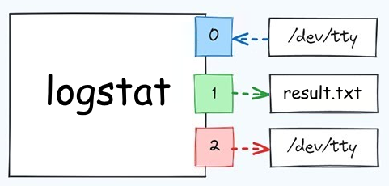</p>

    На картинке `0` - это поток ввода (`cin`); `1` - поток вывода (`cout`); `2` - поток ошибок (`cerr`); `/dev/tty` - окно терминала.

45. Проверьте содержимое файла `"result.txt"` при помощи команды `cat`:

    ```bash
    cat result.txt  # покажет что в result.txt
    type result.txt # Для оболочки cmd
    ```

    Команда `cat` выводит содержимое файла на экран.

46. Выполните команду:

    ```bash
    # В Windows только в cmd или Git Bash
    ./logstat -s DEBUG --format=json < app.log
    ```

    **Важно:** символ `<` и имя файла `"app.log"` НЕ передаются в программу `logstat` как аргументы. Для самой программы список аргументов заканчивается на `--format=json`. Т.е. имя файла не задано и программа переходит в режим чтения данных с клавиатуры.

    Оператор `<` перенаправляет содержимое файла `"app.log"` на стандартный ввод программы (эти данные программа прочитает через `cin` как будто их ввел пользователь).

    <p align="center">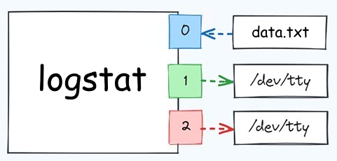</p

47. Выполните команды:

    ```bash
    ./logstat --format=json < app.log > result.txt
    cat result.txt  # bash (WSL / Git Bash / Linux)
    type result.txt # Для оболочки cmd
    ```

    На экране вы ничего не увидите, т.к. данные из файла `"app.log"` передаются программе как ввод с клавиатуры, а вывод сохраняется в файл `"result.txt"`. Поток ошибок (`stderr`, в C++ это `std::cerr`) по прежнему направлен на экран.

    При желании можно и поток ошибок куда-нибудь перенаправить, для этого перед `>` или `>>` ставится цифра 2, т.е. `2>` или `2>>`. Чтобы переправить сразу и поток вывод и поток ошибок в один файл `&>`.

48. Выполните команду:

    ```bash
    cat result.txt | ./logstat  # bash (WSL / Git Bash / Linux)
    type result.txt | .\logstat # Для оболочки cmd
    ```

    В данном случае мы используем `pipe` (труба). Символ `|` позволяет перенаправить стандартный вывод первой программы (`cout`) на стандартный ввод второй программы (`сin`). При этом остальные потоки, при необходимости тоже можно перенаправлять, например передав вывод `logstat` следующей программе.

    <p align="center">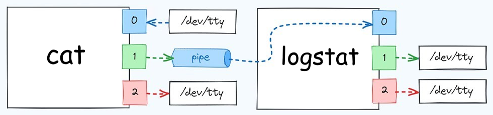</p>

    Можно рассматривать `|` как аналог `<`, но только второй работает для файлов, а первый для программ.

49. Выполните команду:

    ```bash
    cat result.txt | ./logstat --format=json | sort  # bash (WSL / Git Bash / Linux)
    type result.txt | .\logstat --format=json | sort # Для оболочки cmd
    ```

    Здесь вывод команды `logstat` далее передаётся на стандартный ввод команде `sort`, а вывод команды `sort` уже связан с терминалом.

#### Go

50. В `"projects\lab2"` создайте каталог `"arguments"`, а в нём каталог `"go"`;

51. В терминале перейдите в `"projects\lab2\arguments\go"` или запустите в этом каталоге `vscode`, по вашему выбору;

52. Создайте файл: `"main.go"` содержащий:

    ```go
    package main
    
    import (
    	"fmt"
    	"os"
    )
    
    func main() {
    	fmt.Println(len(os.Args))
    }
    ```

    В отличие от C++ функция `main` в Go НЕ может принимать параметры. Аргументы командной строки складываются в срез `os.Args`. Соответственно `len(os.Args)` - это количество аргументов, включая имя самой программы (`os.Args[0]`).

53. В терминале выполните команду компиляции:

    ```bash
    go build -o main.exe main.go # Windows
    go build -o main main.go     # Linux
    ```

    В результате в текущем каталоге появится исполняемый файл `"main"`.

    > Заметьте `go` - команда; `build` - подкоманда; `-o main` - ключ с аргументом; `main.go` - позиционный аргумент.

54. Запустите программу:

    ```bash
    ./main
    ```

    Вывод должен быть `1`, т.к. в `os.Args` один элемент - имя программы.

55. Модифицируйте `"main.go"`:

    ```go
    package main
    
    import (
    	"fmt"
    	"os"
    )
    
    func main() {
    	for i, arg := range os.Args {
    		fmt.Printf("%d: %s\n", i, arg)
    	}
    }
    ```

56. Скомпилируйте программу и выполните команды:

    ```bash
    ./main a
    ./main -m hello world
    ./main -m "hello world"
    ```

57. Создайте в текущем каталоге файл `"app.log"` содержащий:

    ```
    INFO starting up
    DEBUG loading config
    INFO connected to db
    WARN slow query 1200ms
    ERROR timeout on db
    ERROR disk full
    INFO shutting down
    ```

    Этот файл имитирует лог работы некоторой программы.

58. Создайте в текущем каталоге файл `"logstat.go"` содержащий:

    ```go
    package main
    
    import (
    	"bufio"
    	"fmt"
    	"io"
    	"os"
    	"strings"
    )
    
    // -- дефолтные настройки в коде --
    var (
    	gLevel = "ERROR"     // Максимальный уровень
    	gFile  = "app.log"   // Имя файла с логами
    )
    
    // -- значимость уровня: DEBUG < INFO < WARN < ERROR --
    func rank(level string) int {
    	switch level {
    	case "DEBUG": return 0
    	case "INFO":  return 1
    	case "WARN":  return 2
    	case "ERROR": return 3
    	}
    	return -1
    }
    
    // -- обработка записей в логе --
    func process(r io.Reader) {
    	max_rank := rank(gLevel)
    	sc := bufio.NewScanner(r)
    	for sc.Scan() {
    		line := sc.Text()
    		level := strings.SplitN(line, " ", 2)[0]
    		if rank(level) > max_rank {  // критичнее порога — пропускаем
    			continue
    		}
    		fmt.Println(line)
    	}
    }
    
    func main() {
    	log, _ := os.Open(gFile) // Открываем файл с логом
    	defer log.Close()        // Закрываем файл в конце функции
    	process(log)
    }
    ```

    Здесь представлена программа, для анализа логов. Как видно, она не принимает аргументы, но содержит настройки зашитые в переменных. Имя файла и максимальный уровень выводимых логов фиксированы.

59. Скомпилируйте программу и запустите её:

    ```bash
    ./logstat
    ```

    Как видно, программа отобразила все записи из лог-файла.

60. Изменим код так, чтобы имя файла указывалось пользователем как **обязательный позиционный** аргумент программы. Такие аргументы должны быть указаны строго в определённом месте и строго в определённом порядке:

    ```go
    package main
    
    import (
    	"bufio"
    	"fmt"
    	"io"
    	"os"
    	"strings"
    )
    
    // -- дефолтные настройки в коде --
    var (
    	gLevel = "ERROR" // Максимальный уровень
    	gFile  = ""      // <- Теперь тут пусто
    )
    
    
    // -- значимость уровня: DEBUG < INFO < WARN < ERROR --
    func rank(level string) int {
    	switch level {
    	case "DEBUG": return 0
    	case "INFO":  return 1
    	case "WARN":  return 2
    	case "ERROR": return 3
    	}
    	return -1
    }
    
    // -- обработка записей в логе --
    func process(r io.Reader) {
    	max_rank := rank(gLevel)
    	sc := bufio.NewScanner(r)
    	for sc.Scan() {
    		line := sc.Text()
    		level := strings.SplitN(line, " ", 2)[0]
    		if rank(level) > max_rank {
    			continue
    		}
    		fmt.Println(line)
    	}
    }
    
    // -- обработка флагов --
    func parseArgs(args []string) {
    	if len(args) > 0 {
    		gFile = args[0]
    	}
    }
    
    func main() {
    	parseArgs(os.Args[1:])    // Обрезаем имя программы и обрабатываем
    	if gFile == "" {          // Если имя не задано
    		os.Stderr.WriteString("ERROR Need to specify the file name")
    		os.Exit(1)            // нет файла — ошибка
    	}
    	log, _ := os.Open(gFile)
    	defer log.Close()
    	process(log)
    }
    ```

    Здесь используется поток ошибок `os.Stderr` для вывода на экран информации об ошибке. В отличие от С++ `os.Stdout`, тоже не накапливает данные во внутреннем буфере как и `os.Stderr` и вся информация попадает на экран сразу. Но разделять ошибки и обычный вывод - это правила хорошего тона, т.к. позволяет через операторы перенаправления `>` и `>>` отфильтровывать только нужную информацию.

61. Скомпилируйте программу и запустите её:

    ```bash
    ./logstat
    ./logstat app.log
    ```

    В первом случае вы должны получить ошибку, а во втором вывод записей и лог-файла.

62. Изменим код следующим образом:

    - Добавьте в список импортов `flag`.

    - Измените функцию `main`:

      ```go
      func main() {
      	parseArgs() // Убираем параметр. Будем пользоваться библиотекой flag
      	if gFile == "" {
      		printUsage(os.Stderr) // Справка по работе с функцией
      		os.Exit(1)
      	}
      	f, _ := os.Open(gFile)
      	defer f.Close()
      	process(f)
      }
      ```

    - Изменяете функцию `parseArgs`:

      ```go
      func parseArgs() {
      	flag.Usage = func() { printUsage(os.Stderr) }  // переопределяем стандартный вывод
      	flag.Parse() // Обрабатывает флаги программы
      	if flag.NArg() > 0 {
      		gFile = flag.Arg(0)
      	}
      }
      ```

      Здесь добавлена обработка двух флагов `-h` и `--help`. Обработка этих флагов идёт из коробки при использовании стандартной библиотеки `flag`.

      Пакет`flag` автоматически вызывает функцию `flag.Usage` со стандартным форматом вывода если встретит `-h` или `--help`, она может автоматически выводить все обнаруженные флаги и без необходимости описывать их в ручную, но здесь, мы специально заменяем стандартную функцию на свою, чтобы выводить свой текст.

      Аргументы, которые не обязательны для работы программы, называют флагами, опциями или ключами. Обычно их записывают с одним минусом (для коротких, однобуквенных вариантов) или с двумя (для длинных). В оболочке `cmd` вместо минуса используют слеш `/` - это особенность команд, написанных специально для этой оболочки.

      Ключи, как правило, можно указывать в любом порядке, но чаще их ставят перед позиционными аргументами - так проще разбирать параметры в коде и понятнее читать команды.

      Пакет `flag` не обрабатывает позиционные аргументы, разбор флагов останавливается перед первым не-флаговым аргументом. К тому, что останется можно получить доступ через `flag.Args()` (срез) и `flag.NArg()` (количество). В нашем случае там будет лежать имя лог-файла, если его задали.

    - Перед функцией `parseArgs` добавьте:

      ```go
      // -- справка --
      func printUsage(w io.Writer) {
      	fmt.Fprintf(w, `Usage: logstat [options] <logfile>
      
      Print lines from a log file, filtered by level.
      
      Options:
        -h, --help      show this help and exit
      `)
      	flag.CommandLine.SetOutput(w)   // PrintDefaults в тот же поток
      	flag.PrintDefaults()            // Печатаем остальные флаги
      }
      ```

      Функция `flag.PrintDefaults()`  автоматически формирует и выводит описание флагов (кроме `-h`, `--help`), поэтому воспользуемся ей, чтобы не писать всю справку руками.

63. Скомпилируйте и проверьте работоспособность программы:

    ```bash
    ./logstat
    ./logstat -h
    ./logstat --help
    ./logstat app.log
    ```

64. Изменим код следующим образом:

    - Обновите `parseArgs`:

      ```go
      func parseArgs() {
      	flag.Usage = func() { printUsage(os.Stderr) }
      	flag.StringVar(&gLevel, "s", gLevel, "show LEVEL and less critical")
      	flag.Parse()
      	if flag.NArg() > 0 {
      		gFile = flag.Arg(0)
      	}
      }
      ```

      Здесь добавлена поддержка дополнительного ключа `-s` - он задаёт максимальный уровень выводимых логов. Для простоты длинную форму вроде `--log-level` задавать пока не будем.

      Обратите внимание, что если этот ключ обнаружен, то следующий за ним аргумент считается значением данного ключа. Если же после `-s` не указать значение, возникнет ошибка: программа попытается прочитать следующий аргумент как данные для ключа, а им окажется что‑то не то (или вообще ничего) - в итоге логика разбора параметров сломается.

      Такой тип ключей называется **ключами со значением** (или **опциями с аргументом**). Это отличает их от булевых флагов (вроде `-h` или `--help`), которые сами по себе уже несут смысл и не требуют дополнительного значения.

      Пакет `flag` берёт разбор аргументов на себя, но сначала нужно "сказать" ему, что искать. Для этого мы используем функцию `flag.StringVar`, который описывает ключ со значение типа `string` и именем `s`. Кстати, ключ без значения добавляется через `flag.BoolVar`: такой флаг можно указать просто как `-v` или явно задать значение - `-v=true`, `-v=false`.
      **Важно:** форма `-v true` (через пробел) для булевых флагов не работает - слово `true` в этом случае останется позиционным аргументом, и разбор на нём закончится.

      Некоторые программы позволяют повторять такие ключи несколько раз, чтобы передать список значений - по сути, сформировать массив. Например, в Docker с помощью многократного указания ключа `-p` можно пробросить несколько портов. В стандартном пакете `flag` такого режима нет из коробки, но он легко реализуется при помощи собственного типа и функции `flag.Value`.

65. Скомпилируйте и проверьте работоспособность программы:

    ```bash
    ./logstat -h
    ./logstat app.log
    ./logstat -s INFO app.log
    ./logstat --s INFO app.log
    ./logstat -s=INFO app.log
    ./logstat --s=INFO app.log
    ```

    Как видно, пакет `flag` автоматически добавляет поддержку как `-`, так `--`. Кроме того значение ключа можно указывать как через пробел, так и через `=`. Минус в том, что вы не можете ограничить такое поведение, а получаете всё сразу. При этом значение флага без минусов или с другим префиксом (например `/`) пакет `flag` из коробки не позволяет обработать.

66. Изменим код следующим образом:

    - Добавите к списку дефолтных значение новое:

      ```go
      gFormat = "text"
      ```

    - Обновите `parseArgs`:

      ```go
      func parseArgs() {
      	flag.Usage = func() { printUsage(os.Stderr) }
      	flag.StringVar(&gLevel, "s", gLevel, "show LEVEL and less critical")
      	flag.StringVar(&gFormat, "format", gFormat, "text | json | csv")
      	flag.Parse()
      	if flag.NArg() > 0 {
      		gFile = flag.Arg(0)
      	}
      }
      ```

      Здесь добавлена поддержка дополнительного ключа `--format` - он задаёт формат вывода нашей программы: json, csv или text. Это тоже ключ со значением, но в другой форме записи.

      Как было показано выше, для пакета `flag` нет разницы один минус перед именем флага стоит или два. Точно так же как и значение может быть задано как через пробел (кроме булевых), так и через `=`. Этот флаг с точки зрения обработки идентичен флагу `-s`.

    - Обновите `process`:

      ```go
      func process(r io.Reader) {
      	max_rank := rank(gLevel)
      	sc := bufio.NewScanner(r)
      	for sc.Scan() {
      		line := sc.Text()
      		parts := strings.SplitN(line, " ", 2)
      		level := parts[0]
      		msg := parts[1]
      		if rank(level) > max_rank  {
      			continue
      		}
              
      		switch gFormat {
      		case "json":
      			fmt.Printf("{\"level\":\"%s\",\"msg\":\"%s\"}\n", level, msg)
      		case "csv":
      			fmt.Printf("%s,%s\n", level, msg)
      		default:
      			fmt.Println(line)
      		}
      	}
      }
      ```

67. Скомпилируйте и проверьте работоспособность программы:

    ```bash
    ./logstat -h
    ./logstat -s DEBUG --format=json app.log
    ./logstat --format=csv -s INFO app.log
    ```

68. Изменим код следующим образом:

    - Добавите к списку дефолтных значение новое:

      ```go
      gMode = "print"
      ```

    - Замените `parseArgs`:

      ```go
      func parseArgs() *flag.FlagSet {
      	args := os.Args[1:]
      	if len(args) > 0 && (args[0] == "print" || args[0] == "count") {
      		gMode = args[0]
      		args = args[1:]
      	}
      
      	fs := flag.NewFlagSet(gMode, flag.ExitOnError)
      	fs.Usage = func() { printUsage(os.Stderr, fs) }
      	fs.StringVar(&gLevel, "s", gLevel, "show LEVEL and less critical")
      	if gMode == "print" {
      		fs.StringVar(&gFormat, "format", gFormat, "text | json | csv")
      	}
      	fs.Parse(args)
      
      	if fs.NArg() > 0 {
      		gFile = fs.Arg(0)
      	}
      	return fs
      }
      ```

      Часто первый позиционный аргумент имеет особое значение: он переключает программу в другой режим работы - такой аргумент называют **подкомандой**.

      В нашем случае добавлены две подкоманды: `print` - режим обычного вывода (используется по умолчанию); `count` - вместо вывода записей из лог‑файла программа подсчитывает их количество.

      Обычно каждая подкоманда имеет свой собственный набор ключей, в пакете `flag`, для этого используется функция `flag.NewFlagSet` с указанием имени подкоманды и поведения, при ошибках парсинга. В нашем случае, для подкоманды `print` будут работать оба ключа `-s` и `--format`, а для подкоманды `count`, только `-s`; ключ `--format` для неё приведёт к ошибке.

      Как говорилось выше, пакет `flag` останавливается, при обнаружении позиционного аргумента (без минусов в начале), поэтому название подкоманды мы обрабатываем руками и отрезаем от общего списка аргументов.

    - Обновите `process`:

      ```go
      func process(r io.Reader) {
      	max_rank  := rank(gLevel)
      	count := 0
      	sc := bufio.NewScanner(r)
      	for sc.Scan() {
      		line := sc.Text()
      		parts := strings.SplitN(line, " ", 2)
      		level := parts[0]
      		msg := parts[1]
      		if rank(level) > max_rank  {
      			continue
      		}
      		count++
      		if gMode == "count" {
      			continue
      		}
              
      		switch gFormat {
      		case "json":
      			fmt.Printf("{\"level\":\"%s\",\"msg\":\"%s\"}\n", level, msg)
      		case "csv":
      			fmt.Printf("%s,%s\n", level, msg)
      		default:
      			fmt.Println(line)
      		}
      	}
      	if gMode == "count" {
      		fmt.Println(count)
      	}
      }
      ```

    - Обновите `print_usage`:

      ```go
      func printUsage(w io.Writer, fs *flag.FlagSet) {
      	fmt.Fprintf(w, `Usage: logstat [print|count] [options] <logfile>
      
      Read a log file (or stdin) and print matching lines (print),
      or just count them (count).
      
      Commands:
        print             print matching lines (default)
        count             print the number of matching lines
      
      Options:
        -h, --help      show this help and exit
      `)
          fs.SetOutput(w)
      	fs.PrintDefaults()
      }
      ```

      Добавили описание подкоманд, и поправили строку `Usage`. Теперь дополнительно нужно принимать второй аргумент, который показывает с каким конкретно множеством флагов мы работаем. Это множество будет манятся в зависимости от подкоманды.

    - Обновите `main`:

      ```go
      func main() {
      	fs := parseArgs() // <- Приняли множество флагов
      	if gFile == "" {
      		printUsage(os.Stderr, fs) // <- Передали
      		os.Exit(1)
      	}
      	f, _ := os.Open(gFile)
      	defer f.Close()
      	process(f)
      }
      ```

69. Скомпилируйте и проверьте работоспособность программы:

    ```bash
    ./logstat print -h
    ./logstat count -h
    ./logstat -s WARN app.log
    ./logstat print -s WARN app.log
    ./logstat count -s WARN app.log
    ./logstat count --format=json .\app.log
    ```

    Как видно, в зависимости от подкоманды выводится свой набор флагов. А последняя команда завершилась ошибкой с сообщением о том, что флаг `--format` не поддерживается, и вывела справку по доступным флагам.

70. Измените функцию `main` следующим образом:

    ```go
    func main() {
    	parseArgs()
    
    	var in io.Reader = os.Stdin // Поток по умолчанию Stdin
    	if gFile != "" {            // Если имя файла задано
    		f, _ := os.Open(gFile)  // Открываем файл
    		defer f.Close()
    		in = f                  // Входной поток берём из файла
    	}
    	process(in)
    }
    ```

    Здесь мы меняем поведение программы на следующее: если пользователь не укажет имя файла, то мы не кидаем в него справкой, в переключаемся в режим ввода с клавиатуры.

71. Скомпилируйте и проверьте работоспособность программы:

    ```bash
    ./logstat app.log
    ./logstat
    ```

    **Внимание!** Когда запустите программу без аргументов, введите несколько строк и чтобы сообщить программе, что ввод закончен (конец файла) нажмите сочетание клавиш Ctrl+D (Linux, macOS, WSL) иногда нужно нажать дважды. Для Windows (cmd и PowerShell) используйте Enter, Ctrl+Z и Enter.

    Так же сочетанием клавиш Ctrl+C можно принудительно закрыть программу.

Подробнее рассматривать стандартный пакет `flag` мы не будем, т.к. он не очень удобен для сложных программ с интерфейсом командной строки. Для Go существует множество альтернативных решений, которые более удобны в использовании, например:

| Библиотека                                                   | Подходит для                  | Сложность | Основные особенности                  |
| ------------------------------------------------------------ | ----------------------------- | --------- | ------------------------------------- |
| [`cobra`](https://cobra.dev/)                                | Большие проекты               | Средняя   | Поддержка подкоманд, автодополнение   |
| [`urfave/cli`](https://cli.urfave.org/)                      | Простые и средние проекты     | Низкая    | Лёгкий синтаксис, гибкость            |
| `flag`                                                       | Маленькие проекты             | Низкая    | Встроена в стандартную библиотеку     |
| [`go-flags`](https://github.com/jessevdk/go-flags?tab=readme-ov-file) | Проекты со сложной структурой | Средняя   | Работа с аргументами через структуры  |
| [`spf13/pflag`](https://github.com/spf13/pflag)              | CLI с POSIX-совместимостью    | Низкая    | Расширение стандартного пакета `flag` |

Перенаправление потоков ввода и вывода, пайпы и др. точно так же работают для программы на Go как и для программ на С++ (и на других языках), т.к. это функционал самой оболочки.

### Переменные окружения

> [!WARNING]
>
> Этот раздел нужно выполнить на Windwos **и** на Linux. Часть для Linux можно выполнить либо в Docker-контейнере, либо на виртуальной машине, либо в WSL и т.д.

Каждая программа при запуске получает набора переменных окружения. Переменные окружения (или переменные среды) - это набор пар ключ-значение (значение - всегда строкового типа):

```bash
KEY=value
NAME="John Smith"
AGE=28
```

Переменные окружения можно сравнить с глобальными переменными в программе, но только существующими на уровне операционной системы. Так же как функции могут получать данные из глобальных переменных, программы могут получать данные из переменных окружения. Но есть и существенное отличие - переменные окружения передаются программе в виде **копии** переменных окружения родительского процесса:

```bash
[ОС] --порождает--> [Процесс 1] --порождает--> [Процесс 2]
  |
  └  --порождает--> [Процесс 3]
```

Как следствие:

- Изменение переменных окружения внутри программа никак не повлияет на значение переменных родительского процесса или его предков;
- Если вы изменили системные переменные среды, то программу (например терминал) нужно перезапустить, чтобы она получила обновлённые значения переменных, иначе они будет старые;
- Процесс может изменять значение своих переменных среды перед тем, как запустить дочерний процесс. Тогда дочерний процесс получит изменённые значения переменных.

Переменные окружения позволяют программе получить дополнительную информацию о системе. Часто через них передают пути к конфиг-файлам, имя пользователя, секреты и т.д. Переменные окружения в их современном виде появились в 1979 году в седьмой версии Unix (Unix V7), и до сих пор актуальны особенно часто они используются в практиках DevOps.

> [!NOTE]
>
> Командные оболочки `bash`, `cmd`, `PowerShell` и т.д. в дополнении к переменным среды имеют **переменные оболочки**. С точки зрения использования в самой командной оболочке они ведут себя также как переменные среды, но при создании дочернего процесса, переменные оболочки ему НЕ передаются.
>
> <p align="center">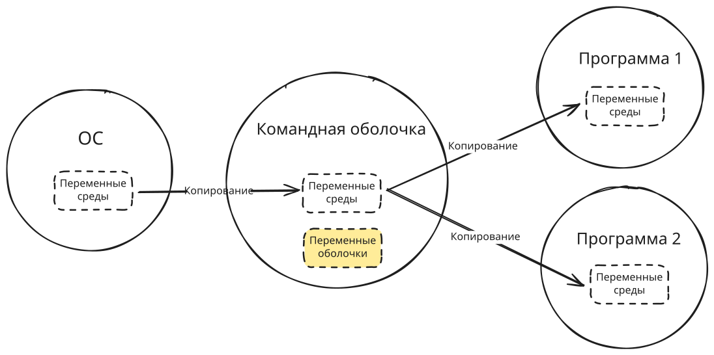</p>

> [!NOTE]
>
> В Unix системах, регистр имён переменных окружения имеет значение, т.е. `PATH` и `Path` - это 2 разные переменные. В Windows, можно писать и так и так, это всё равно будет одна и та же переменная.
>
> Традиционно имена переменных окружения пишут в верхнем регистре. Это не требование системы, а правило хорошего тона, уменьшающее вероятность потенциальных ошибок.

#### C++ Linux

72. В терминале посмотрите список переменных окружения и их значения:

    ```bash
    printenv # или env
    ```

    Команды [`printenv`](https://manpages.ubuntu.com/manpages/noble/en/man1/printenv.1.html) или [`env`](https://manpages.ubuntu.com/manpages/noble/en/man1/env.1posix.html) запущенные без аргументов позволяют посмотреть список переменных окружения.

73. В `"projects\lab2"` создайте каталог `"environment"`, а в нём каталог `"cpp"`;

74. В терминале перейдите в `"projects\lab2\environment\cpp"` или запустите в этом каталоге `vscode`, по вашему выбору;

75. В текущем каталоге создайте файл `"my_env.cpp"` содержащий:

    ```cpp
    #include <iostream>
    #include <cstdlib>  // Для environ
    
    extern char** environ;
    
    int main() {
        for (int i=0; environ[i] != nullptr; i++) {
            std::cout << environ[i] << std::endl;
        }
    }
    ```

    В заголовочном файле `"unistd.h"` (или `"cstdlib"`) объявлен внешний двумерный массив строк `environ`. При страте программы переменная `environ` инициализируется значением указывающим на копию окружения процесса.

    <p align="center">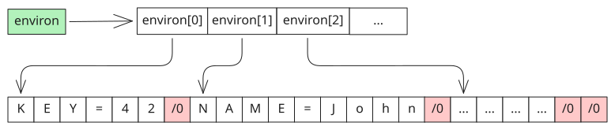</p>

    Для массива `environ` известно, что его `n+1` элемент равен нулевому байту, поэтому мы продолжаем чтение данных до тех пор, пока не дойдём до этого элемента.

    > Выше сказано, что `environ` указывает на **копию** окружения процесса. Это получается вот почему:
    >
    > - При старте процесса, операционная система создаёт структуру описывающую процесс и копирует переменные окружения родительского процесса в эту структуру (не совсем так, но почти);
    > - **Стандартная библиотека** С/С++ выполняет дополнительное копирование переменных окружения из этой структуры себе в память.

76. Скомпилируйте и запустите программу:

    ```bash
    g++ my_env.cpp -o my_env
    ./my_env
    ```

    В результате вы получите список переменных окружения, которые программа получила от командной оболочки.

77. В терминале выполните команды:

    ```bash
    echo $PATH     # Печтатем значение переменной среды PATH
    MY_LOCAL=123   # Создаём свою переменную оболочки (НЕ среды)
    echo $MY_LOCAL # Печтатем значение переменной оболочки MY_LOCAL
    ```

    Обратите внимание, что пробелов нигде быть не должно. Если значение переменной содержит пробел, то его (значение) нужно взять в кавычки, либо экранировать пробел символом `\`.

78. Выполните команду:

    ```bash
    ./my_env
    ```

    И попробуйте найти переменную `MY_LOCAL`. Т.к. наша программа является дочерним процессом для командной оболочки, то она получает от неё все переменные среды, но не переменные оболочки.

79. Выполните команду:

    ```bash
    export MY_LOCAL
    ```

    Этой командой мы назначаем переменную оболочки `MY_LOCAL` переменой среды, но только для текущего сеанса. Т.е., пока терминал открыт `MY_LOCAL` будет вести себя как переменная среды для текущей оболочки и для всех её дочерних процессов. Когда терминал закроют никаких следов от `MY_LOCAL` не останется. Кроме того `MY_LOCAL` существует только в текущем терминал, и если открыть другой, то `MY_LOCAL` там не будет.

80. Выполните команду:

    ```bash
    ./my_env
    ```

    И попробуйте найти переменную `MY_LOCAL`. Она должна быть в списке, потому-что наша программа получила её от оболочки.

81. Выполните команды:

    ```bash
    MY_ONE_RUN_VAR=42 ./my_env
    ./my_env
    ```

    Обратите внимание, что при первом запуске в списке переменных окружения была `MY_ONE_RUN_VAR`, но при втором уже нет. Такой способ запуска программы позволят задать или поменять значение переменной среды, но только для текущего запуска программы.

82. Выполните команды:

    ```bash
    unset MY_LOCAL
    ./my_env
    ```

    И попробуйте найти переменную `MY_LOCAL`. Её снова не должно быть в списке, т.к. мы удалили её командой `unset`.

83. В текущем каталоге создайте файл `"shifter.cpp"` содержащий:

    ```cpp
    #include <iostream>
    #include <string>
    #include <cstdlib>  // Для getenv
    
    int main() {
        std::string str;
        if (std::getenv("FULLMOON") != nullptr) str = std::getenv("FULLMOON"); // Если переменная существует
    
        if (str == "True") std::cout << "I am a werewolf" << std::endl;
        else std::cout << "I am human" << std::endl;
    }
    ```

    Здесь функция [`getenv`](https://en.cppreference.com/w/cpp/utility/program/getenv) позволяет найти переменную среды, если она была передана, по её названию. Под капотом `getenv` использует `environ`.

84. Скомпилируйте и запустите программу:

    ```bash
    ./shifter
    FULLMOON=True ./shifter
    ```

85. В текущем каталоге создайте файл `"check.cpp"` содержащий:

    ```cpp
    #include <iostream>
    #include <string>
    #include <cstdlib>  // Для getenv, putenv, unsetenv
    
    int main(int argc, char* argv[]) {
        if (argc != 2) return 1;
    
        // Проверяем значение переменной
        if (std::getenv(argv[1]) != nullptr) std::cout << argv[1] << " = " << std::getenv(argv[1]) << std::endl;
        else std::cout << argv[1] << " not exist" << std::endl;
    
        // Изменяем значение переменной
        std::string str = argv[1];
        str += "=VALUE"; // Формат ИМЯ=ЗНАЧЕНИЕ
        putenv(str.data());
        // Проверяем
        if (std::getenv(argv[1]) != nullptr) std::cout << argv[1] << " = " << std::getenv(argv[1]) << std::endl;
        else std::cout << argv[1] << " not exist" << std::endl;
    
        // Удаляем переменную
        unsetenv(argv[1]);
        // Проверяем
        if (std::getenv(argv[1]) != nullptr) std::cout << argv[1] << " = " << std::getenv(argv[1]) << std::endl;
        else std::cout << argv[1] << " not exist" << std::endl;
    }
    ```

    Здесь используется функция `putenv` для изменения значения переменной или для создания переменной, если она не существовала и функция `unsetenv` для удаления переменной. Под капотом они используют `environ`. Каждый раз, когда переменные среды модифицируются происходит их перемещение в новое место и как следствие изменение `environ`.

    Эти функции полезны в том случае, если вы собираетесь запускать дочерний процесс (например поток) и хотите изменить для него значения переменных окружения. Или вы хотите загрузить переменные окружения из файла.

    > Как говорилось выше, одной из популярных практик является конфигурирование программы через `.env` файлы. Это обычный текстовый файл, который содержит список переменных окружения необходимых приложению для работы:
    >
    > ```
    > DB_HOST=local_db_host
    > DB_PORT=local_db_port
    > DB_NAME=local_db_name
    > DB_USER=local_db_user
    > ```
    >
    > При старте, программа загружает этот файл и если переменная среды не установлена, то берётся значение из файла. Если установлено, то переменная среды имеет приоритет.
    >
    > Правилами хорошего тона считается размещение в репозитории проекта файла с именем `".env.example"`, который должен хранить список необходимых для заполнения переменных. При этом реальный `.env` файл добавлять в репозиторий нельзя.

86. Скомпилируйте и запустите программу:

    ```bash
    ./check ANSWER
    ANSWER=42 ./check ANSWER
    ```

Часто требуется, чтобы переменная среды была доступна не только в текущем сеансе оболочки, а на постоянной основе. Как и всё в Unix это требует внесение изменений в какой-то файл. Подобнее об этом можно почитать например [здесь](https://wiki.merionet.ru/articles/peremennye-okruzheniya-v-linux-kak-posmotret-ustanovit-i-sbrosit).

Кроме рассмотренного выше способа доступа к переменным среды через `environ` существует второй. Многие реализации (в частности, распространённые UNIX-подобные системы и MSVC) позволяют функции `main` принимать третий аргумент `envp`, который при старте программы обычно указывает на тот же блок переменных окружения, что и `environ`:

```cpp
int main(int argc, char* argv[], char* envp[]){
    // Используем envp также как и environ
}
```

Проблема этого способа проявляется при изменении значений переменных окружения. Функции, изменяющие среду, работают с новой копией в новой области памяти и автоматически обновляют глобальный указатель `environ`, но **не** `envp`. В результате `envp` продолжает указывать на блок переменных, полученный программой при запуске, и не отражает внесённые изменения.

Следует также учитывать, что `main` с тремя параметрами не предусмотрена стандартом C++ и является нестандартным расширением, хотя и поддерживается многими компиляторами.

#### C++ Windows

В Windows работа с переменными окружения:

- Если использовать компилятор `g++` и стандартную библиотеку С++, то код будет таким же как и для Linux. Единственное, в Windows функция `unsetenv("VAR_NAME");` не работает, вместо этого используйте: `putenv("VAR_NAME=");`. Если значение не указано, то переменная считается не установленной;
- Если использовать компилятор от Microsoft (например в Visual Studio) и стандартную библиотеку С++, то можно написать такой же код, как и для Linux, но IDE будет ругаться на небезопасные функции `getenv`, `putenv`. Это можно обойти, если добавить в начало кода (перед включением `cstdlib`) строку `#define _CRT_SECURE_NO_WARNINGS`. В противном случае, среда откажется собирать код, пока вы не замените их на их безопасные версии (среда скажет на какие именно). Эти версии отличаются по сигнатуре, поэтому код придётся немного доработать;
- Кроме стандартной библиотеки С++, Windows предоставляет собственное API позволяющее работать с переменными окружения. Для использования API нужно подключить [`processenv.h`](https://learn.microsoft.com/ru-ru/windows/win32/api/processenv/) или `windows.h`, который подключает всё нужное внутри себя. В отличие от функций из стандартной библиотеки, которые были рассмотрены ранее, функции WinAPI работают не с собственной копией переменных окружения, а с их теми значениями которые были переданы программе. По этой причине не желательно смешивать функции стандартной библиотеки С++ и WinAPI в одном коде, т.к. изменения переменных окружения через функции WinAPI могут быть не видны функциям из стандартной библиотеки и наоборот.

Далее будет рассмотрено использование функций WinAPI для работы с переменными окружения. 

87. В VScode:

    - Откройте вкладку "Terminal" и убедитесь, что у вас открыта оболочка PowerShell;
    - Нажмите на символ "стрелка вниз" рядом с `+` и в открывшемся меню выберите Command Prompt (это оболочка cmd). В результате справа откроется маленькое окно со списком запущенных терминалов;
    - В списке терминалов возьмите и перетащите PowerShell в левую часть открытого cmd. В результате у вас должно получится 2 одновременно открытых терминала.

    <p align="center">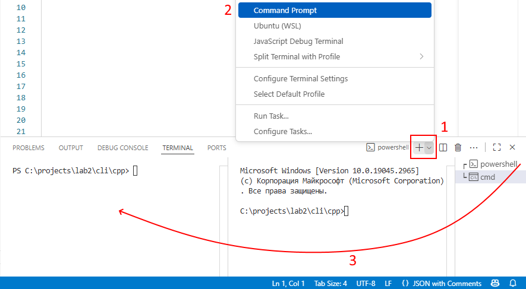</p>

88. Посмотрите список переменных окружения и их значения:

    - cmd:

       ```cmd
       set
       ```
       
    - PowerShell:

       ```powershell
       Get-ChildItem Env: # или 
       gci env: # или 
       dir env:
       ```

89. Если в первой работе вы создавали профиль VScode для С++, то переключитесь на него, чтобы активировались соответствующие плагины, если нет, то убедитесь, что у вас установлен набор расширений *C/C++ Extension Pack*.

    Так же предполагается, что у вас, локально установлен компилятор `g++`. Проверить это можно командой (в любой оболочке):

    ```bash
    g++ --version
    ```

    > На самом деле можно использовать и компилятор от Майкрософт, но в этом случае нужно открыть оболочки PowerShell и cmd как внешние, т.е. в меню Пуск запустить *"Developer PowerShell for Visual Studio"* и *"Developer Command Prompt for Visual Studio"* и перейти в них в каталог `"projects\lab2\cli\cpp"`.

    > Вместо VScode можно использовать IDE Visual Studio, но в этом случае нужно также открыть оболочки PowerShell и cmd как внешние и кроме того, скомпилированный файл будет лежать НЕ в папке и сходным кодом, и это нужно учитывать при выполнении пунктов задания.

90. В текущем каталоге, через интерфейс VScode создайте файл `"my_env_win.cpp"` содержащий:

    ```cpp
    #undef UNICODE       // Чтобы использовать обычные char вместо широких wchar
    #include <windows.h> // Внути подключается processenv.h
    #include <iostream>
    
    int main() {
        auto env = GetEnvironmentStrings();
        if (env == nullptr) {
            std::cerr << "GetEnvironmentStrings failed" << std::endl;
            return 1;
        }
        
        auto current = env; // Компируем, чтобы не менять env, он понадобится в конце
        while (*current) {
            std::cout << current << std::endl;
            current += strlen(current) + 1;
        }
        
        FreeEnvironmentStrings(env);
    }
    ```

    Здесь мы используем функцию WinAPI [`GetEnvironmentStrings`](https://learn.microsoft.com/ru-ru/windows/win32/api/processenv/nf-processenv-getenvironmentstrings) чтобы получить указатель на место в памяти в котором находятся переменные среды (можно воспринимать его как аналог `environ` из стандартной библиотеки). Согласно документации после работы нужно сообщить системе, что данный участок памяти вам больше не нужен при помощи функции [`FreeEnvironmentStrings`](https://learn.microsoft.com/ru-ru/windows/win32/api/processenv/nf-processenv-freeenvironmentstringsa).

    Функция `GetEnvironmentStrings` возвращает нам указатель на одномерный массив символов, в котором переменные среды расположены последовательно друг за другом и разделены нулевым байтом (т.е. это С-строки). В конце гарантировано лежит пустая строка благодаря которой мы можем понять, что достигли конца списка.

    <p align="center"></p>

    После того, как мы выводим на экран очередную переменную среды мы перемещаем указатель на начало следующей при помощи функции [`strlen`](https://en.cppreference.com/w/cpp/string/byte/strlen) (возвращает длину С-строки, т.е. количество символов до ближайшего `\0`). Чтобы перешагнуть за нулевой байт прибавляем к длине строки единицу.

    > В начале кода, перед подключением `windows.h` указана строка `#undef UNICODE`. Это связано с тем, что в Windows есть две версии функции `GetEnvironmentStrings`. Одна работает с обычными однобайтовыми `char`, а вторая с двухбайтовыми (широкими) `wchar`.
    >
    > Не будем вдаваться в подробности, но не текущий момент нам удобнее работать с простыми `char`, т.к. для широких пришлось бы использовать "широкие версии" всех стандартных функций, например вместо `cout` нужно было бы `wcout` и т.д.

91. Скомпилируйте программу (в любом терминале):

    ```cmd
    g++ my_env_win.cpp -o my_env.exe
    ```

    и запустите:

    - cmd:

      ```cmd
      my_env
      ```

      Для оболочки `cmd` можно указать просто имя. По умолчанию она сначала ищет программу в текущем каталоге, а потом по путям указанным в `PATH`;

    - PowerShell:

      ```powershell
      .\my_env
      ```

      По умолчанию оболочка PowerShell НЕ ищет программы в текущем каталоге, поэтому мы должны дописать `.\` перед именем программы, чтобы явно попросить оболочку об этом.

92. Добавьте новую переменную:

    - cmd:

      ```cmd
      echo %PATH%       # Печтатем значение переменной среды PATH
      set MY_LOCAL=123  # Создаём свою переменную среды
      echo %MY_LOCAL%   # Печaтаем значение переменной среды MY_LOCAL
      ```

      В оболочке `cmd` нет переменных оболочки. Значение `MY_LOCAL` будет добавлено к переменным среды и следовательно дочерние процессы тоже её получат.

    - PowerShell:

      ```powershell
      echo $env:PATH      # Печтатем значение переменной среды PATH
      $MY_LOCAL = "value" # Создаём свою переменную оболочки
      echo $MY_LOCAL      # Печатем значение переменной оболочки MY_LOCAL
      ```

      В PowerShell **переменные оболочки** дополнительно делятся по областям видимости:

      ```powershell
      # Локальная область (по умолчанию). Применяется к текущей функции, блоку скрипта или оболочке
      $localVar = "value"
           
      # Глобальная область. Переменные, определённые в глобальной области, доступны везде: в функциях, скриптах, модулях и оболочке
      $global:globalVar = "value"
           
      # Область скрипта. Применяется к текущему .ps1-файлу. Переменная в области скрипта доступна во всём скрипте, включая вложенные функции, но не выходит за пределы скрипта
      $script:scriptVar = "value"
           
      # Приватная область. Переменные с областью Private доступны только в пределах текущей области, где они определены, и не доступны во вложенных или внешних областях видимости
      $private:privateVar = "value"
      ```

93. Запустите `my_env` в каждой из оболочек и убедитесь, что в `cmd` переменная `MY_LOCAL` присутствует в списке, а в PowerShell нет.

94. Чтобы сделать переменную оболочки переменной окружения выполните:

    - cmd: как было сказано ранее в `cmd` нет переменных оболочки, поэтому никаких специальных действий не требуется;

    - PowerShell:

      ```powershell
      $MY_LOCAL=123            # Создаём свою переменную оболочки
      $env:MY_LOCAL=$MY_LOCAL  # Теперь это переменная среды
      ```

      В отличие от оболочки `bash` в Linux, в PowerShell появляется вторая (не связанная с первой) переменная `env:MY_LOCAL`. При изменении `MY_LOCAL`, значение `env:MY_LOCAL` не поменяется и наоборот.

95. Запустите `my_env` в PowerShell и убедитесь, что теперь переменная `MY_LOCAL` появилась в списке.

96. В текущем каталоге создайте файл `"get_moon.cpp"` содержащий:

    ```cpp
    #undef UNICODE       // Чтобы использовать обычные char вместо широких wchar
    #include <windows.h> // Внути подключается processenv.h
    #include <iostream>
    
    int main() {
        const int bufSize = 32767;
        char buffer[bufSize];
        auto count = GetEnvironmentVariable("FULLMOON", buffer, bufSize);
        if (count == 0) {
            std::cerr << "GetEnvironmentVariable failed" << std::endl;
            return 1;
        }
        if (count == bufSize) {
            std::cerr << "Buffer too small" << std::endl;
            return 1;
        }
        
        std::cout << "FULLMOON = " << buffer << std::endl;
    }
    ```

    Здесь мы используем функцию WinAPI [`GetEnvironmentVariable`](https://learn.microsoft.com/ru-ru/windows/win32/api/processenv/nf-processenv-getenvironmentvariablea), чтобы получить значение конкретной переменной окружения. Эта функция принимает на вход имя переменной, буфер, который получит значение указанной переменной окружения в виде С-строки и размер буфера. Как результат возвращается количество символов записанное в буфер (в конце добавляется нулевой байт, но не учитывается к количестве символов).

    Размер буфера должен быть как минимум на единицу больше, чем значение в переменной среды (+1 для нулевого байта в конце). Если передать буфер меньшего размера чем значение переменной оболочки, то он будет заполняться пока не кончится. Здесь мы используем буфер размером 32767, т.к. в документации указано, что переменная среды имеет максимальный размер 32767 символов, включая нулевой байт.

    Буфер можно будет использовать повторно.

97. Скомпилируйте программу `get_moon` и запустите в обеих оболочках без установки переменной `FULLMOON`, затем установите `FULLMOON` любое значение, сделайте её переменной среды и повторно запустите программу.

98. Модифицируйте `"get_moon.cpp"` следующим образом:

    ```cpp
    #undef UNICODE       // Чтобы использовать обычные char вместо широких wchar
    #include <windows.h> // Внути подключается processenv.h
    #include <iostream>
    
    int main() {
        const int bufSize = 32767;
        char buffer[bufSize];
        // Читаем переменную FULLMOON
        auto count = GetEnvironmentVariable("FULLMOON", buffer, bufSize);
        if (count == 0) {
            // Если FULLMOON не установлено, устанавливаем
            if (!SetEnvironmentVariable("FULLMOON", "default value")){
                std::cerr << "SetEnvironmentVariable failed" << std::endl;
                return 1;
            }
        }
        
        // Повторно читаем переменную FULLMOON
        count = GetEnvironmentVariable("FULLMOON", buffer, bufSize);
        if (count == 0) {
            std::cerr << "GetEnvironmentVariable failed" << std::endl;
            return 1;
        }
    
        std::cout << "FULLMOON = " << buffer << std::endl;
    }
    ```

    Здесь была добавлена функция WinAPI [`SetEnvironmentVariable`](https://learn.microsoft.com/ru-ru/windows/win32/api/processenv/nf-processenv-setenvironmentvariablea) которая принимает на вход имя переменной и значение. Если переменная существует, она будет изменена, если нет, то создана. Если в качестве значения указать `nullptr` (или `NULL`) то переменная будет удалена (аналог `unsetenv` из стандартной библиотеки).

99. Скомпилируйте и запустите `get_moon` в обеих оболочках.

    На текущий момент у вас переменная `FULLMOON` должна быть установлена, поэтому вы увидите своё значение.

100. Чтобы удалить переменную оболочки выполните:

     - cmd:

       ```cmd
       set FULLMOON=
       ```
       
     - PowerShell:

       ```powershell
       rm env:FULLMOON
       ```

101. Запустите `get_moon` повторно в обеих оболочках.

     На текущий момент переменная `FULLMOON` удалена и вы должны получить в выводе `"default value"`.

Системные переменные окружения к Windows хранятся в реестре. Чтобы переменная среды была доступна не только в текущем сеансе оболочки, а на постоянной основе можно отредактировать реестр, выполнить определённую команду в терминале, но проще всего внести изменения через графический интерфейс как это описано, например [здесь](https://remontka.pro/environment-variables-windows/).

#### Go Windows/Linux

В случае с Go мы будем используем только стандартную библиотеку, т.к. отдельного API для Go операционные системы не предоставляют, поэтому код для Windows и Linux будет одинаковым. Кроме того, Go поддерживает возможность кросскомпиляции, т.е. мы можем на одной операционной системе собирать приложения для всех остальных (обычно ОС на которой собирают программу должна совпадать с целевой ОС).

Далее все команды будут указаны для Windows и оболочки PowerShell, вы можете использовать другую ОС и оболочку или даже выполнять работу в Docker-контейнере, виртуальной машине, WSL и т.д.

102. Создайте файл `"my_env.go"` содержащий:

     ```go
     package main
     
     import (
     	"fmt"
     	"os"
     )
     
     func main() {
     	envs := os.Environ()
     	for _, e := range envs {
     		fmt.Println(e)
     	}
     }
     ```

     Здесь мы используем `os.Environ()`, чтобы получить слайс с переменными среды.

103. Скомпилируйте и запустите программу :

     ```bash
     go build my_env.go
     
     ./my_env
     ```

104. Создайте файл `"do_env.go"` содержащий:

     ```go
     package main
     
     import (
     	"flag"
     	"fmt"
     	"os"
     )
     
     func main() {
     	action := flag.String("action", "set", "")
     	flag.Parse()
     	name := flag.Arg(0)
     
     	switch *action {
     	case "look":
     		{
     			val, exists := os.LookupEnv(name)
     			if !exists {
     				fmt.Printf("%s not exist\n", name)
     				return
     			}
     			fmt.Printf("%s = %s\n", name, val)
     		}
     	case "get":
     		{
     			fmt.Printf("%s = %s\n", name, os.Getenv(name))
     		}
     	case "set":
     		{
     			os.Setenv(name, flag.Arg(1))
     			fmt.Printf("%s = %s\n", name, os.Getenv(name))
     		}
     
     	case "unset":
     		{
     			os.Unsetenv(name)
     			val, exists := os.LookupEnv(name)
     			if !exists {
     				fmt.Printf("%s not exist\n", name)
     				return
     			}
     			fmt.Printf("%s = %s\n", name, val)
     		}
     	default:
     		{
     			fmt.Println("action not in [look, get, set, unset]")
     		}
     	}
     }
     ```

     Как видно для получения конкретного значения, изменения и удаления переменной среды используются соответствующие функции: `os.Getenv`, `os.Setenv` и `os.Unsetenv`.

     Функция `os.Getenv` возвращает пустую строку если переменная не существует, но с другой стороны сама переменная может существовать и иметь пустое значение. Если для вас важно отличать эти два случая, то можно воспользоваться функцией `os.LookupEnv`, которая возвращает само значение и булев флаг существования переменной. 

105. Скомпилируйте и запустите программу:

     ```bash
     go build do_env.go
     
     .\do_env --action=look MY_VAR
     .\do_env --action=get MY_VAR
     .\do_env --action=set MY_VAR 42
     .\do_env --action=unset MY_VAR
     ```

     Затем установите значение переменной окружения и повторите проверку:

     ```bash
     $env:MY_VAR=1
     
     .\do_env --action=look MY_VAR
     .\do_env --action=get MY_VAR
     .\do_env --action=set MY_VAR 42
     .\do_env --action=unset MY_VAR
     ```

Как было сказано ранее, стандартной практикой сейчас является использование файлов `.env`. Мы не рассматривали работу с `.env` файлами в С++, поэтому рассмотрим здесь.

106. Создайте в текущем каталоге файл `".env"` содержащий:

     ```ini
     API_URL=http://example.com/api
     API_KEY=1234567890
     ```

107. Создайте файл `"get_dotenv.go"` содержащий:

     ```go
     package main
     
     import (
     	"fmt"
     	"log"
     	"os"
     
     	"github.com/joho/godotenv"
     )
     
     func main() {
     	err := godotenv.Load()
     	if err != nil {
     		log.Fatal("Error loading .env file")
     	}
     
     	apiURL := os.Getenv("API_URL")
     	apiKey := os.Getenv("API_KEY")
     	fmt.Println(apiURL)
     	fmt.Println(apiKey)
     }
     ```

     Здесь мы используем функцию `godotenv.Load()` из стороннего пакета `"github.com/joho/godotenv"`. По умолчанию будет загружен файл `".env"`, но можно указать другие имена.

108. Установите и добавьте пакет `"github.com/joho/godotenv"` в проект при помощи команд:

     ```bash
     go get github.com/joho/godotenv
     go mod tidy
     ```

109. Скомпилируйте и протестируйте работоспособность программы:

     ```bash
     go build get_dotenv.go
     
     .\get_dotenv
     $env:API_KEY="ABCD"
     .\get_dotenv
     ```

     Как видно, если переменная окружения не задана, то будет использовано значение из файла `.env`, а если задана, то значение из файла игнорируется.

Для более продвинутой работы с переменными среды, с конфиг-файлами и многим другим можно воспользоваться пакетом [Viper](https://github.com/spf13/viper).
